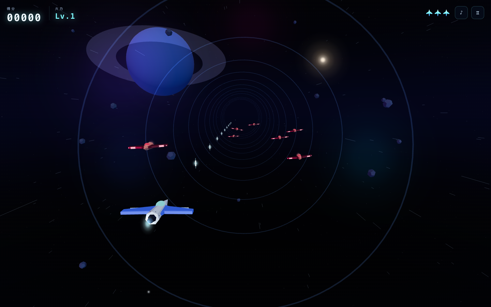
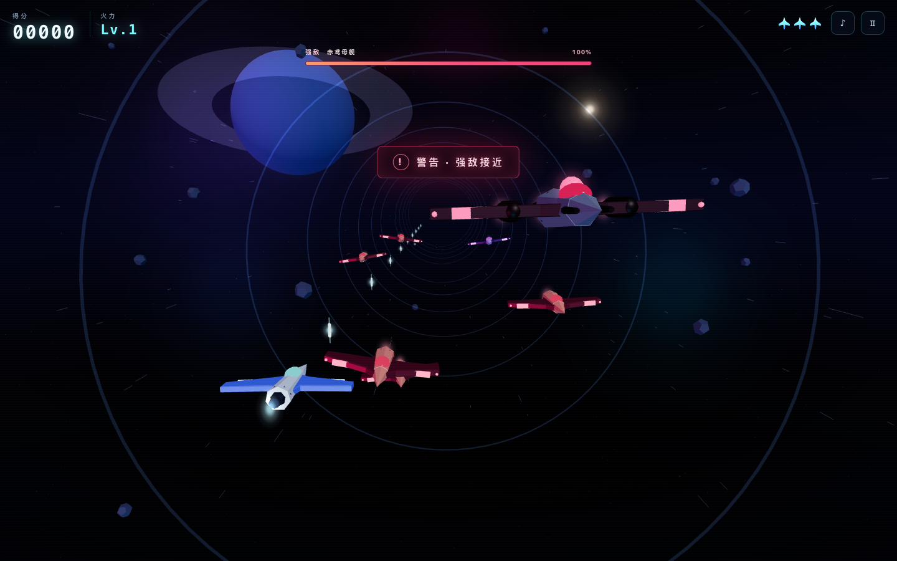
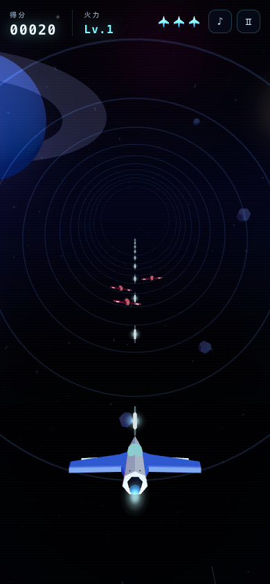

# 飞机大战 · Three.js 3D 星海

使用 [three.js](https://threejs.org/) 实现的 3D 深空飞机大战。透视追尾镜头、纵深俯冲的敌机、星尘跃迁、能量环、行星与陨石全部由代码生成，不依赖任何外部美术或音频素材。

这是 `dsh-superagent` 原型测试仓库中的一次完整交付。


## 玩法

- **3D 追尾视角**：镜头位于战机后上方，敌机从星海深处俯冲而来，距离越近体型越大。
- **自动开火**：专注走位与瞄准，不用连按射击键。弹道沿纵深飞行，左右上下对准敌机即可命中。
- **三种敌机**：侦察机、截击机（会瞄准射击）、重炮机（三连散射），随时间逐步登场。
- **Boss 战**：首轮 32 秒后「赤鸢母舰」从深空跃入战场，循环三种弹幕（瞄准连射、锥形环爆、扇形弹幕）。
- **火力升级**：击落敌机有概率掉落 `P` 强化道具，火力从 Lv.1 升到 Lv.3（三向散射）；满级后拾取改为加分。道具会向战机缓慢漂移，靠近时自动吸附。
- **三条命 + 重生护盾**：受击后短暂无敌闪烁，最高分保存在本地。
- **完整流程**：主菜单、暂停、结算、重新开始，支持桌面鼠标/键盘与移动端触控。





## 操作

| 操作 | 按键 |
| --- | --- |
| 移动 | `WASD` / 方向键 / 鼠标移动 |
| 移动（触屏） | 在屏幕上拖拽，战机跟随手指的相对位移 |
| 开火 | 自动 |
| 暂停 / 继续 | `P` / `Esc` |
| 静音 | `M` |
| 开始 / 重新开始 | `Enter` / `Space` / 界面按钮 |

移动端与桌面端布局均已适配，画面会按屏幕比例自动调整战场宽度。



## 本地运行

```bash
npm install
npm run dev        # http://localhost:5173
```

生产构建与预览：

```bash
npm run build
npm run preview    # http://localhost:4173
```

## 测试

```bash
npm test
```

`src/game/core/combat.js` 中的 3D 球体碰撞、扫掠命中、向量工具、弹道与难度曲线与 three.js 解耦，使用 Vitest 覆盖。

## 项目结构

```
index.html                 # 页面骨架、HUD 与菜单
src/style.css              # 霓虹街机风格 UI、扫描线与响应式布局
src/main.js                # 启动入口
src/game/Game.js           # 游戏循环、状态机、3D 相机、生成器与碰撞调度
src/game/UI.js             # HUD / 菜单 / 暂停 / 结算 DOM 控制
src/game/constants.js      # 相机、玩家、敌机、Boss、弹道参数
src/game/core/combat.js    # 可单测的纯逻辑（3D 碰撞/弹道/难度）
src/game/core/Input.js     # 键盘、鼠标、相对触控拖拽
src/game/core/Audio.js     # WebAudio 程序化音效
src/game/models/planes.js  # 低多边形战机、引擎光效与精灵贴图
src/game/entities/         # Player / Enemy / Boss / Bullet / PowerUp
src/game/world/            # 三维星海背景与 3D 粒子爆炸
tests/combat.test.js       # 规则单元测试
docs/screenshots/          # 3D 交付截图
docs/screenshots/before-3d/ # 升级前的 2D 俯视截图（对比用）
```

## 实现说明

- 透视相机（FOV 60°）位于战机后上方，战机在 `z = 0` 平面附近机动；敌机在 `z ≈ -180` 的深空生成，以 25–46 单位/秒的速度沿纵深俯冲，靠近后体积与弹道透视自然放大。
- 命中判定使用 3D 球体距离；高速子弹额外做线段扫掠检测，避免一帧跨过敌机造成穿透。
- 背景由多层 3D 星点、跃迁光条、能量环隧道、低多边形陨石、行星与星云精灵组成，全部按纵深运动并循环回收；引擎光、爆炸冲击波与灼热核心使用始终面向相机的精灵。
- 实体几何体与材质通过模板克隆复用；爆炸使用逐帧更新的 `Points` 粒子、冲击波环与核心闪光，避免堆叠过多 draw call。
- Boss、敌机、子弹和道具都使用 3D 球体碰撞体；玩家机体判定半径小于外观，属于街机式宽容判定。
- 音效由振荡器与滤波噪声实时合成，首次点击「开始游戏」时解锁 `AudioContext`。
- 页面失焦或切换标签页会自动暂停；静音与最高分写入 `localStorage`。
