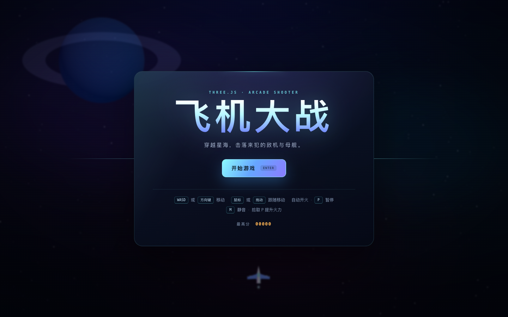
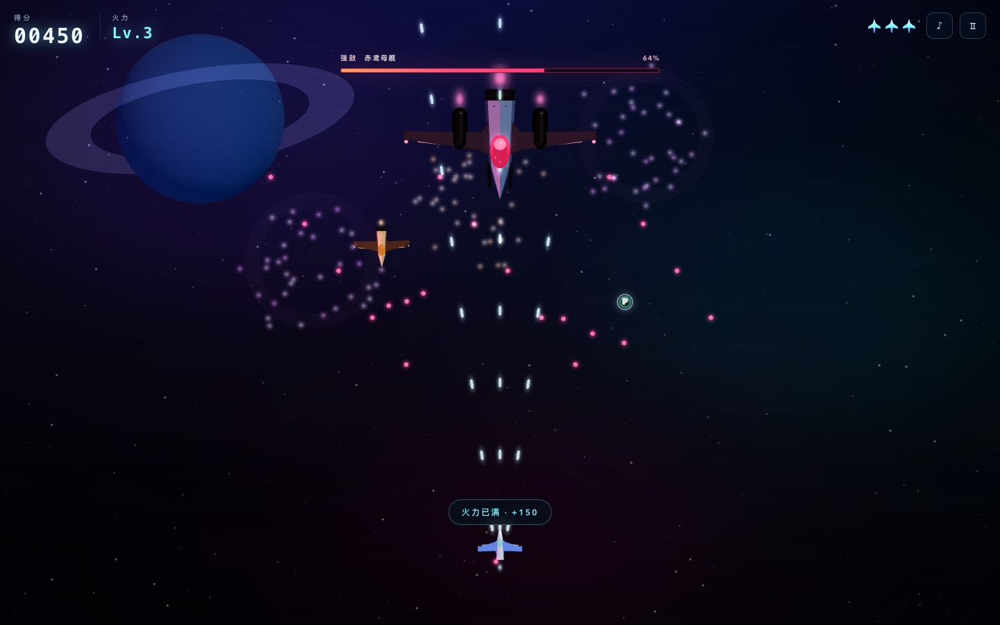
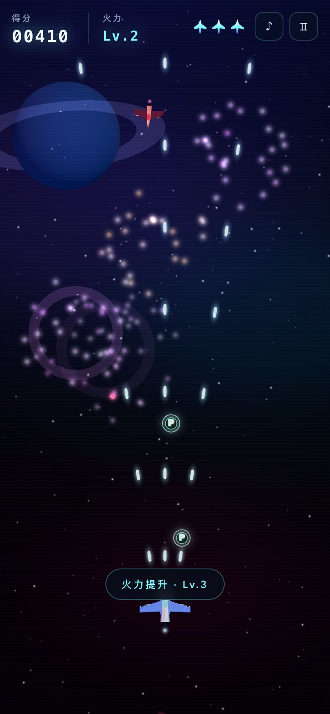

# 飞机大战 · Three.js Arcade

使用 [three.js](https://threejs.org/) 实现的纵向卷轴飞机大战。星空、战机、粒子爆炸与音效全部由代码生成，不依赖任何外部美术或音频素材。

这是 `dsh-superagent` 原型测试仓库中的一次完整交付。



## 玩法

- **自动开火**：专注走位与躲避，不用连按射击键。
- **三种敌机**：侦察机、截击机（会瞄准射击）、重炮机（三连散射），随时间逐步登场。
- **Boss 战**：首轮 32 秒后「赤鸢母舰」来袭，循环三种弹幕（瞄准连射、环形弹幕、扇形弹幕）。
- **火力升级**：击落敌机有概率掉落 `P` 强化道具，火力从 Lv.1 升到 Lv.3（三向散射）；满级后拾取改为加分。
- **三条命 + 重生护盾**：受击后短暂无敌闪烁，最高分保存在本地。
- **完整流程**：主菜单、暂停、结算、重新开始，支持桌面鼠标/键盘与移动端触控。



## 操作

| 操作 | 按键 |
| --- | --- |
| 移动 | `WASD` / 方向键 / 鼠标移动 |
| 移动（触屏） | 在屏幕上拖拽，战机跟随手指的相对位移 |
| 开火 | 自动 |
| 暂停 / 继续 | `P` / `Esc` |
| 静音 | `M` |
| 开始 / 重新开始 | `Enter` / `Space` / 界面按钮 |

移动端与桌面端布局均已适配，画面会按屏幕比例自动调整战场宽度。



## 本地运行

```bash
npm install
npm run dev        # http://localhost:5173
```

生产构建与预览：

```bash
npm run build
npm run preview    # http://localhost:4173
```

## 测试

```bash
npm test
```

`src/game/core/combat.js` 中的碰撞检测、武器弹道、难度曲线和向量工具与 three.js 解耦，使用 Vitest 覆盖。

## 项目结构

```
index.html                 # 页面骨架、HUD 与菜单
src/style.css              # 霓虹街机风格 UI、扫描线与响应式布局
src/main.js                # 启动入口
src/game/Game.js           # 游戏循环、状态机、生成器与碰撞调度
src/game/UI.js             # HUD / 菜单 / 暂停 / 结算 DOM 控制
src/game/constants.js      # 玩家、敌机、Boss、弹道参数
src/game/core/combat.js    # 可单测的纯逻辑（碰撞/弹道/难度）
src/game/core/Input.js     # 键盘、鼠标、相对触控拖拽
src/game/core/Audio.js     # WebAudio 程序化音效
src/game/models/planes.js  # 低多边形战机与引擎光效
src/game/entities/         # Player / Enemy / Boss / Bullet / PowerUp
src/game/world/            # 星空、行星、星云背景与粒子爆炸
tests/combat.test.js       # 规则单元测试
docs/screenshots/          # 交付截图
```

## 实现说明

- 正交相机把三维低多边形战机放在同一 2D 战斗平面上，既保留体积光照，也让命中判定保持直观。
- 实体几何体与材质通过模板克隆复用；爆炸使用逐帧更新的 `Points` 粒子与冲击波环，避免堆叠过多 draw call。
- Boss、敌机、子弹和道具都使用圆形碰撞体；玩家机体判定半径小于外观，属于街机式宽容判定。
- 音效由振荡器与滤波噪声实时合成，首次点击「开始游戏」时解锁 `AudioContext`。
- 页面失焦或切换标签页会自动暂停；静音与最高分写入 `localStorage`。
